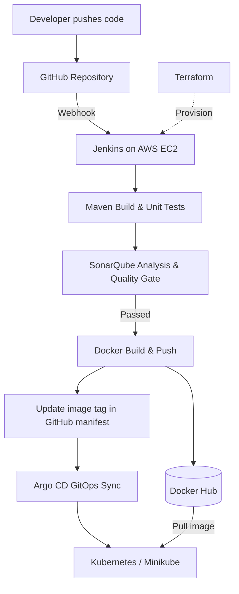
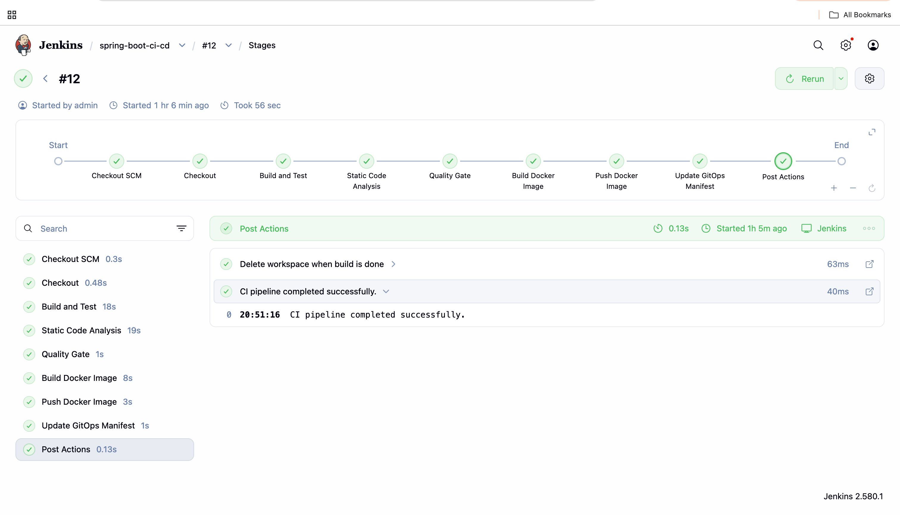
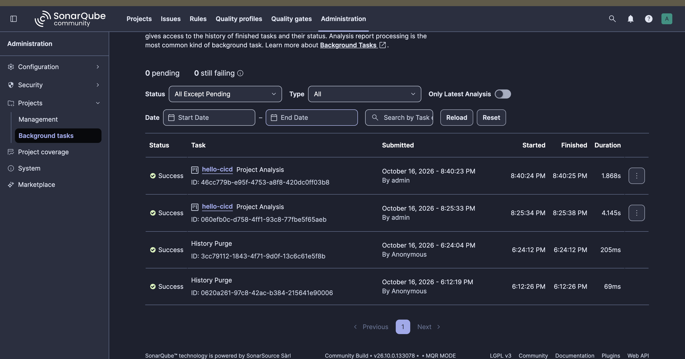
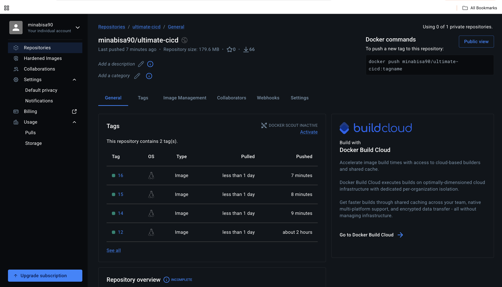
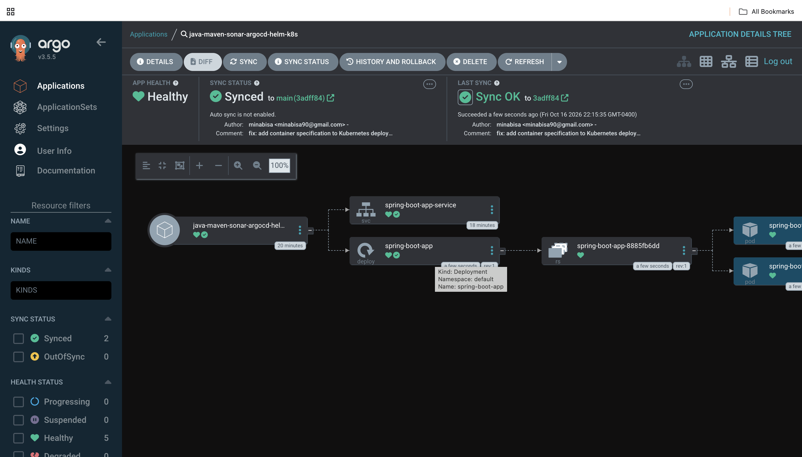

# 🚀 End-to-End CI/CD & GitOps Pipeline

### Java Spring Boot · Jenkins · SonarQube · Docker · Kubernetes · Argo CD

**Automating application delivery from GitHub commit to Kubernetes deployment**

     

---

## 📌 Project Overview

Built a hands-on CI/CD and GitOps workflow for a **Java 17 Spring Boot** application. **Terraform** provisions AWS infrastructure for Jenkins and SonarQube. Jenkins builds and tests the app, runs SonarQube analysis, publishes a versioned Docker image, and updates the Kubernetes manifest. **Argo CD** synchronizes that manifest to a local **Minikube** cluster.

## 🏗️ Architecture

## ⚙️ Pipeline Workflow

1. **Code:** GitHub webhook triggers Jenkins after an application change.
2. **Build & Test:** Maven compiles the application and runs unit tests.
3. **Code Quality:** SonarQube analyzes code; the Quality Gate must pass.
4. **Containerize:** Jenkins builds and pushes a tagged image to Docker Hub.
5. **GitOps:** Jenkins updates `spring-boot-app-manifests/deployment.yml` in GitHub.
6. **Deploy:** Argo CD synchronizes the updated manifest to Minikube.

## 📸 Project Screenshots

| Jenkins Pipeline | SonarQube Quality Gate |
|---|---|
|  |  |

| Docker Hub | Argo CD Deployment |
|---|---|
|  |  |

> Add your screenshots to the `screenshots/` folder using the filenames above.

## 🛠️ Challenges Solved

- Fixed **Java/Maven agent version mismatches** and failing unit tests.
- Resolved **SonarScanner cache permissions**, server configuration, and Quality Gate integration.
- Corrected **Docker CLI access** and **Docker Hub token permissions** in Jenkins.
- Debugged **Kubernetes Deployment YAML** and **Argo CD synchronization** errors.
- Addressed **recursive Jenkins builds** caused by CI-generated GitOps commits.

## 🧰 Tech Stack

**Infrastructure:** AWS EC2, Terraform  
**CI & Quality:** Jenkins, Maven, SonarQube, GitHub Webhooks  
**Containers & CD:** Docker, Docker Hub, Kubernetes, Minikube, Argo CD  
**Application:** Java 17, Spring Boot

## 🔗 Repository & Image

- **Source:** [GitHub repository](https://github.com/minabisa/java-maven-sonar-argocd-helm-k8s)
- **Docker image:** `minabisa90/ultimate-cicd`

---

**Built to practice real-world DevOps automation, troubleshooting, and GitOps delivery.**

