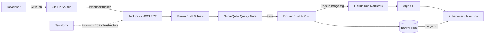

<div align="center">

# 🚀 End-to-End DevOps CI/CD & GitOps Pipeline

### From Java Commit to Kubernetes Deployment

**Terraform · AWS EC2 · Jenkins · Maven · SonarQube · Docker · Argo CD · Kubernetes**

      

[**Source Code**](https://github.com/minabisa/java-maven-sonar-argocd-helm-k8s) · [**Docker Image**](https://hub.docker.com/r/minabisa90/ultimate-cicd) · [**Root Cause Analysis**](docs/ROOT_CAUSE_ANALYSIS.md)

</div>

---

## Overview

I designed and implemented a hands-on **CI/CD and GitOps workflow** for a Java 17 Spring Boot application. I used **Terraform** to provision AWS infrastructure for Jenkins, integrated **Maven tests and SonarQube Quality Gates**, published versioned images to **Docker Hub**, and deployed the application to **Kubernetes (Minikube)** through **Argo CD**.

**Validated outcomes:** A successful Jenkins pipeline, a passing SonarQube Quality Gate, an application reporting **Healthy** in Argo CD, and a working application endpoint accessed through Kubernetes port-forwarding.

## Architecture



> Jenkins builds and publishes application images. Argo CD manages deployment state from Git, separating CI from Kubernetes delivery. Webhook-triggered builds require commit filtering to prevent CI-generated manifest updates from starting a build loop.

## CI/CD Workflow

| Stage | Implementation |
|---|---|
| **Source** | GitHub repository and Jenkins Pipeline |
| **Build & Test** | Java 17, Maven, automated unit tests |
| **Code Quality** | SonarQube static analysis and Quality Gate |
| **Package** | Docker image built from `src/Dockerfile` |
| **Publish** | Versioned images pushed to Docker Hub |
| **GitOps Update** | Jenkins updates the image tag in the Kubernetes manifest |
| **Deploy** | Argo CD synchronizes the manifest to Minikube |

## Project Evidence

> Add your own screenshots to `screenshots/` using these filenames. These image links will display automatically on GitHub once the files exist.

| Jenkins Pipeline | SonarQube Quality Gate |
|---|---|
|  |  |

| Docker Hub | Argo CD / Kubernetes |
|---|---|
|  |  |

## Troubleshooting & Root Cause Analysis

I documented failures encountered during implementation, including the evidence, root cause, fix, and preventive action:

- **Java toolchain:** Resolved `release version 17 not supported` by selecting a Java 17 Maven agent.
- **SonarQube:** Fixed scanner plugin resolution, malformed server URL, `/.sonar` cache permissions, and server-name mismatch.
- **Jenkins / Docker:** Diagnosed `docker: not found` caused by Docker CLI availability and nested agent execution.
- **Docker Hub:** Corrected token authorization for image publishing.
- **Kubernetes / Argo CD:** Fixed invalid Deployment YAML, destination cluster configuration, and Service port-forwarding.
- **Git / automation:** Resolved rebase conflicts and investigated a GitHub webhook feedback loop caused by Jenkins updating manifests in the same repository.

📄 **[Read the detailed Root Cause Analysis](docs/ROOT_CAUSE_ANALYSIS.md)**

## Repository Layout

```text
.
├── Jenkinsfile
├── pom.xml
├── src/
│   ├── Dockerfile
│   ├── main/
│   └── test/
├── spring-boot-app-manifests/
│   ├── deployment.yml
│   └── service.yml
├── helm/
│   └── hello-cicd/
├── terraform/
├── docs/
│   └── ROOT_CAUSE_ANALYSIS.md
└── screenshots/
    ├── jenkins-pipeline.png
    ├── sonarqube-quality-gate.png
    ├── dockerhub-image.png
    └── argocd-deployment.png
```

## Verify the Deployment

After the infrastructure and Minikube cluster are running:

```bash
kubectl get deployments,pods,services
kubectl rollout status deployment/spring-boot-app
kubectl get deployment spring-boot-app \
  -o jsonpath='{.spec.template.spec.containers[0].image}{"\n"}'

# Service exposes port 80 and forwards to the application container.
kubectl port-forward svc/spring-boot-app-service 8080:80
```

In a second terminal:

```bash
curl http://localhost:8080/
```

## Key Takeaways

This project gave me practical experience integrating **infrastructure as code, CI/CD, code quality gates, container delivery, Kubernetes, and GitOps**—and, importantly, troubleshooting failures across the full delivery chain using logs, CLI tools, and systematic root cause analysis.

---

<div align="center">

**Built and documented as a hands-on DevOps engineering portfolio project.**

</div>
